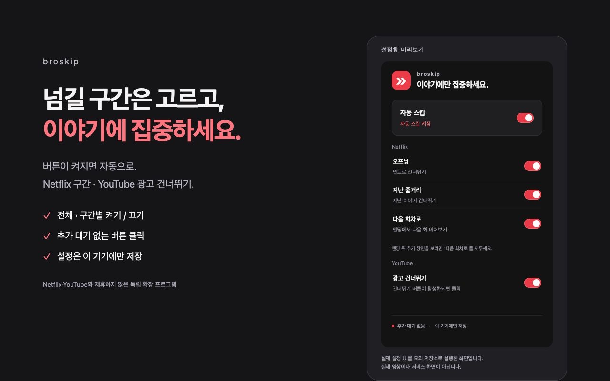

# broskip

**버튼이 켜지면, 이야기는 계속됩니다.**

Netflix의 오프닝·지난 줄거리·다음 회차와 YouTube의 광고 건너뛰기 버튼을 클릭 가능한 시점에 자동으로 누르는 가벼운 Chrome 확장 프로그램입니다. 인위적인 대기나 영상 위 추가 UI 없이 동작합니다.

> Netflix나 YouTube가 제공하거나 승인한 공식 제품이 아닙니다. 자동 테스트·Chrome 모의 화면 검증과 사용자 실사용 보고가 있으며, 계정·회차·운영체제별 검증 범위는 [검증 기록](docs/VALIDATION.md)에 구분합니다.



## 기능

| 기능 | 동작 |
| --- | --- |
| 오프닝 | 인트로 건너뛰기 버튼 자동 클릭 |
| 지난 줄거리 | 지난 이야기 건너뛰기 버튼 자동 클릭 |
| 다음 회차 | 엔딩의 전용 다음 회차 버튼 자동 클릭 |
| YouTube 광고 | 건너뛰기 버튼이 표시·활성 상태일 때 자동 클릭 |
| 설정 | 전체·종류별 ON/OFF, 기기 로컬 저장 |

추천작 일반 재생 버튼, 본편 도중 상시 다음 버튼, 건너뛸 수 없는 광고의 강제 탐색, 영상 분석, 북마크·자막 수집은 포함하지 않습니다. 엔딩 뒤 추가 장면을 보려면 '다음 회차로'를 꺼두세요.

## 설치

**[Chrome 웹스토어에서 설치](https://chromewebstore.google.com/detail/broskip/hdbdcfigldnjlghcmoaojkhokdbdmkna)**

이 브랜치의 0.2.0에는 YouTube 광고 자동 스킵이 추가되어 있습니다. 0.2.0 스토어 업데이트는 아직 제출하지 않았습니다.

PC Chrome에서 스토어 페이지의 **Chrome에 추가**를 누르고 열려 있는 지원 사이트 탭을 새로고침하면 됩니다. 일반 사용자는 ZIP·개발자 모드·Node.js가 필요하지 않습니다.

[설치 및 사용 안내](docs/INSTALL.ko.md) · [개인정보 처리방침](PRIVACY.md)

소스에서 실행하는 개발자는 [기여 안내](CONTRIBUTING.md)를 참고하세요.

## 설계

- **반복 타이머 없음:** DOM 변경과 관련 이벤트에 반응하고 추가된 부분을 중심으로 확인합니다.
- **클릭 시 네트워크·저장소 대기 없음:** 설정은 미리 읽어 메모리에 유지합니다.
- **보수적인 판별:** 정확한 UI hook과 표시·활성 상태를 확인하며 같은 버튼과 즉시 재생성 버튼의 중복을 억제합니다.
- **작은 실행 코드:** 프레임워크·외부 런타임 의존성·백그라운드 워커가 없습니다. 설정창은 열 때만 로드합니다.
- **최소 권한:** storage와 Netflix·YouTube 사이트 콘텐츠 스크립트만 사용합니다. 서버·분석 도구·계정 API·원격 코드가 없습니다.

TypeScript · Chrome Manifest V3 · esbuild · Vitest/jsdom. ZIP 라이브러리는 개발 도구이며 확장 실행 코드에는 포함되지 않습니다.

## 검증과 재현

```sh
npm run check     # 타입 검사 → 회귀 테스트 → 빌드
npm run dev       # http://127.0.0.1:4173 모의 플레이어와 설정창
npm run package   # 웹스토어 제출 ZIP + SHA-256
```

모의 플레이어의 '검증 실행'으로 실제 브라우저에서 버튼 삽입·활성화, 숨김, 중복 억제, 회차 전환 등을 재현합니다. 미리보기 저장소는 실제 Chrome 확장 저장소와 구분합니다. 측정값을 Netflix 실서비스 성능으로 일반화하지 않습니다. [검증 결과와 미확인 범위](docs/VALIDATION.md)

## 개발과 기술 문서

`main`은 배포, `dev`는 개발 통합 브랜치입니다. 모든 `feat/*`·`fix/*` 작업은 최신 `dev`에서 분기하고 `dev` 대상 PR로 통합합니다. 배포는 `dev` → `main` PR에서 검토합니다.

- [개발 흐름과 PR·검증 기준](CONTRIBUTING.md)
- [구조와 기술 선택](docs/ARCHITECTURE.md)
- [이벤트 감지·중복 억제 결정](docs/decisions/001-event-driven-engine.md)
- [엔딩과 추천작 구분 결정](docs/decisions/002-next-episode-boundary.md)
