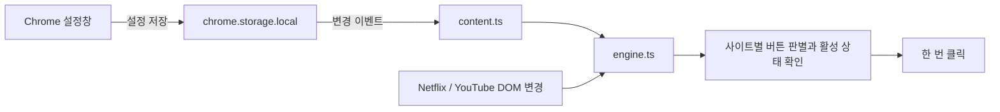

# 구조와 설계 판단

## 파일별 책임

- `adapter.ts`: 사이트별 selector, 재생 경로, 버튼 분류, 활성 조건, SPA 이벤트 계약.
- `netflix.ts`: 기존 Netflix UI 식별자와 재생 경로.
- `youtube.ts`: 실측한 `button.ytp-skip-ad-button`과 `#movie_player.ad-showing`, `/watch?v=…`, `yt-navigate-finish`를 처리한다.
- `actionable.ts`: 두 사이트가 공유하는 표시·비활성·화면 영역 검사.
- `engine.ts`: 변경 감지, 후보 버튼 관리, 회차 경로, 중복 클릭 억제와 설정 반영을 맡는다.
- `content.ts`: Chrome 저장소를 읽고 엔진을 연결한다. 설정을 읽기 전에는 클릭하지 않는다.
- `popup-ui.ts`: UI 상태와 오류 복구. 실제 Chrome 저장소와 모의 저장소를 같은 UI로 검증할 수 있도록 인터페이스를 분리한다.
- `popup.ts`: 실제 Chrome 저장소 연결. 팝업을 열었을 때만 로드된다.
- `demo/`: 실제 영상·계정 없이 동작을 재현하는 개발용 페이지. 배포 확장에는 포함되지 않는다.

## 왜 React나 서버를 쓰지 않았나

표시할 설정은 다섯 개의 스위치뿐이다. 프레임워크 없이 DOM을 직접 갱신하면 실행 의존성·빌드 결과를 작게 유지할 수 있다. 개인 설정은 기기에 저장하며 동기화·로그인·분석 서버가 필요하지 않다.

## 이벤트를 사용하면 항상 0ms인가

아니다. 이벤트 기반 설계는 주기적 검색의 대기 구간을 제거하지만 메인 스레드 지연, 초기 설정 로드, 렌더링과 서비스의 클릭 처리 시간은 남는다. 모의 화면에서 관측한 지연은 해당 환경의 일부 시나리오에 대한 결과이며 서비스 전체 성능을 증명하지 않는다.

## 왜 문서에 observer를 붙이나

Netflix와 YouTube는 페이지 전체를 새로고침하지 않고 browse/watch 전환이나 플레이어 교체를 할 수 있다. 특정 플레이어 노드 하나만 관찰하면 그 노드가 교체될 때 끊길 수 있다. 문서 수명 동안 관찰하되 추가된 부분만 검색하고 관계없는 속성·자막 변경의 레이아웃 재검사를 피한다. 전체 OFF에서는 observer도 분리한다.

## 실제로 발견하고 수정한 문제

추가 노드에 버튼이 없으면 검사를 생략하는 최적화 후, browse에서 watch로 이동할 때 경로 갱신으로 발견한 버튼이 처리되지 않는 회귀가 발생했다. 경로 변경 자체를 유효한 처리 사유로 포함하고 SPA 진입 회귀 테스트로 확인했다.

설정창 미리보기는 실제 DOM 높이가 558px여서 초기 iframe에서 하단 안내가 잘렸다. 실제 브라우저에서 측정하고 미리보기 높이를 늘렸다. 이러한 모의 UI 확인은 확장 설치·Netflix 통합 검증과 구분한다.

## YouTube 지원 경계

광고 플레이어 안의 알려진 네이티브 스킵 버튼이 표시되고 활성화되었을 때만 클릭한다. 광고주 링크, 일반 Next, 텍스트만 비슷한 버튼, 카운트다운은 매칭하지 않는다. 영상 시간·배속·네트워크 요청은 변경하지 않는다. YouTube의 비공개 CSS 클래스는 변경될 수 있으며, 알 수 없는 변형에서는 클릭하지 않는다.

콘텐츠 스크립트는 호스트에 맞는 어댑터 하나만 선택한다. YouTube의 영상 ID만 경로 키로 사용해 재생목록·타임스탬프 변경이 중복 클릭 방지를 초기화하지 않게 한다. 광고 상태가 끝나거나 버튼이 숨겨지면 재사용 버튼을 다시 준비하며, 1.5초 내 즉시 재생성 버튼은 기존 중복 억제 정책을 따른다. 반복 타이머나 추가 런타임 의존성은 없다.
